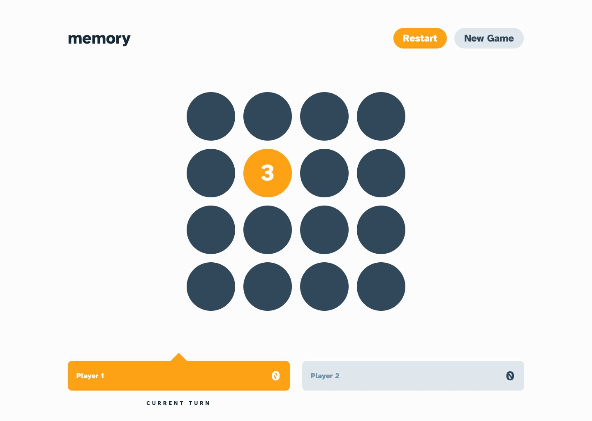

# Frontend Mentor - Memory game solution

This is a solution to the [Memory game challenge on Frontend Mentor](https://www.frontendmentor.io/challenges/memory-game-vse4WFPvM). Frontend Mentor challenges help you improve your coding skills by building realistic projects.

## Table of contents

- [Overview](#overview)
  - [The challenge](#the-challenge)
  - [Screenshot](#screenshot)
  - [Links](#links)
- [My process](#my-process)
  - [Built with](#built-with)
  - [What I learned](#what-i-learned)
  - [Continued development](#continued-development)
  - [Useful resources](#useful-resources)
  - [AI Collaboration](#ai-collaboration)
- [Author](#author)

## Overview

### The challenge

Users should be able to:

- View the optimal layout for the game depending on their device's screen size
- See hover states for all interactive elements on the page
- Play the Memory game either solo or multiplayer (up to 4 players)
- Set the theme to use numbers or icons within the tiles
- Choose to play on either a 6x6 or 4x4 grid

### Screenshot



### Links

- Solution URL: [Add solution URL here](https://your-solution-url.com)
- Live Site URL: [Add live site URL here](https://your-live-site-url.com)

## My process

### Built with

- Semantic HTML5 markup and accessible labels/announcements
- Mobile-first workflow with Tailwind CSS 4 utilities and CSS custom properties
- Flexbox and CSS Grid
- [React 19](https://react.dev/) with TypeScript, Context + `useReducer` and the React Compiler
- [Vite](https://vite.dev/) - build tool and dev server
- [React Router](https://reactrouter.com/) - start and game routes
- [Base UI](https://base-ui.com/) components (via local [shadcn](https://ui.shadcn.com/) wrappers) - dialogs, toggles, buttons
- [Motion](https://motion.dev/) - tile flips, board entrance, dialogs and the current-turn highlight, with reduced-motion support
- [Font Awesome](https://fontawesome.com/) - icons theme

### Getting started

```bash
npm ci          # install the locked dependencies
npm run dev     # start the dev server
npm run lint    # ESLint
npm run build   # type-check and production build
npm run preview # serve the production build
```

### What I learned

### Continued development

### Useful resources

### AI Collaboration

## Author

- Frontend Mentor - [@FerdinandoGeografo](https://www.frontendmentor.io/profile/FerdinandoGeografo)
- LinkedIn - [@FerdinandoGeografo](https://www.linkedin.com/in/ferdinandogeografo/)
- GitHub - [@FerdinandoGeografo](https://github.com/FerdinandoGeografo/)
