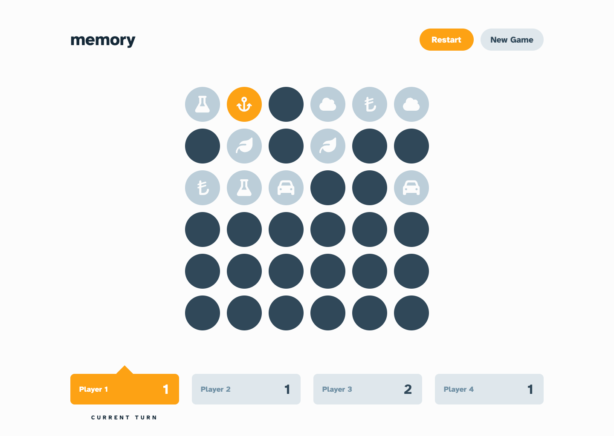
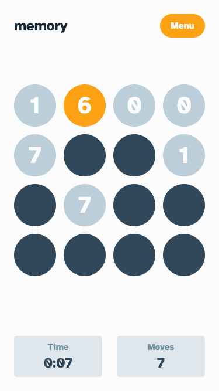
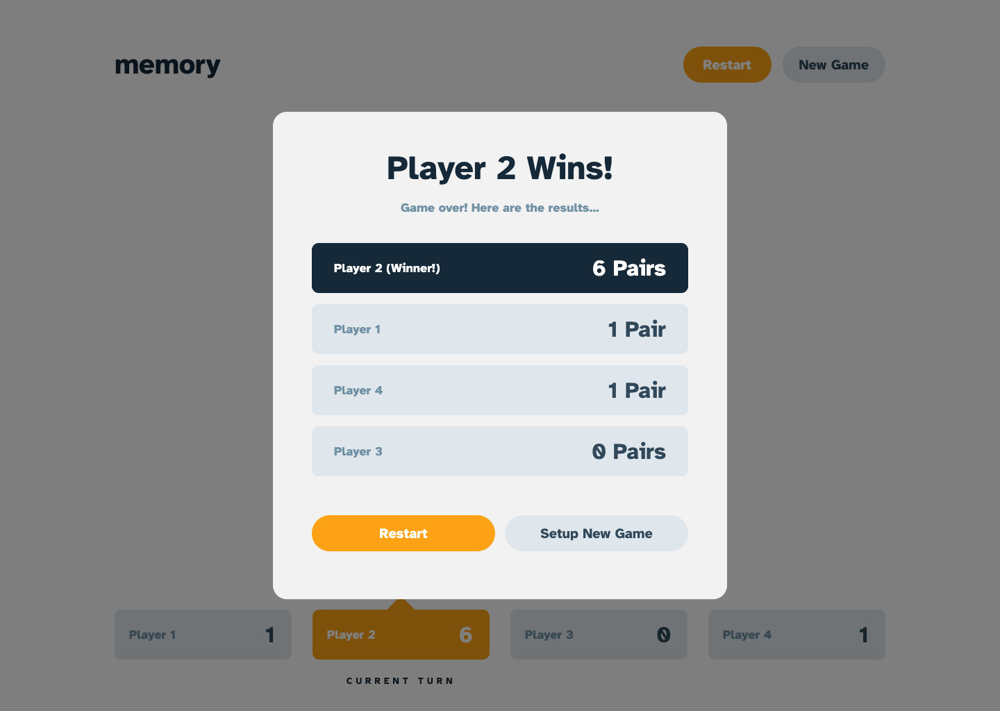

# Frontend Mentor - Memory game solution

This is a solution to the [Memory game challenge on Frontend Mentor](https://www.frontendmentor.io/challenges/memory-game-vse4WFPvM). Frontend Mentor challenges help you improve your coding skills by building realistic projects.

## Table of contents

- [Overview](#overview)
  - [The challenge](#the-challenge)
  - [Screenshots](#screenshots)
  - [Links](#links)
- [My process](#my-process)
  - [Built with](#built-with)
  - [Getting started](#getting-started)
  - [How it works](#how-it-works)
  - [What I learned](#what-i-learned)
  - [Useful resources](#useful-resources)
  - [AI Collaboration](#ai-collaboration)
- [Author](#author)

## Overview

### The challenge

Users should be able to:

- View the optimal layout for the game depending on their device's screen size
- See hover states for all interactive elements on the page
- Play the Memory game either solo or multiplayer (up to 4 players)
- Set the theme to use numbers or icons within the tiles
- Choose to play on either a 6x6 or 4x4 grid

### Screenshots

Captured from the running app.

| Desktop, 4 players, icons, 6x6                                     | Mobile, solo, numbers, 4x4                                           |
| ------------------------------------------------------------------ | -------------------------------------------------------------------- |
|  |  |



### Links

- Repository: [github.com/FerdinandoGeografo/memory-game](https://github.com/FerdinandoGeografo/memory-game)
- Solution and live site: to be added after publishing

## My process

### Built with

- Semantic HTML: a `main` landmark, labelled board and dialogs, and a polite live region for reveals, matches and turns
- Mobile-first layout with Tailwind CSS 4 utilities, CSS Grid and Flexbox, and design tokens in `@theme`
- [React 19](https://react.dev/) with TypeScript (strict), Context + `useReducer` and the [React Compiler](https://react.dev/learn/react-compiler)
- [Vite](https://vite.dev/) - build tool and dev server
- [React Router](https://reactrouter.com/) - `/start` and `/game` routes
- [Base UI](https://base-ui.com/) components through local [shadcn](https://ui.shadcn.com/) wrappers - buttons, toggle groups and dialogs
- [Motion](https://motion.dev/) - tile flips, board entrance, dialogs and the current-turn highlight
- [Font Awesome](https://fontawesome.com/) - tile icons
- [Atkinson Hyperlegible](https://www.brailleinstitute.org/freefont/) Bold, self-hosted as a preloaded WOFF2 (SIL Open Font License)

### Getting started

Requires Node.js and npm.

```bash
npm ci          # install the locked dependencies
npm run dev     # start the dev server
npm run lint    # ESLint
npm run build   # type-check and production build
npm run preview # serve the production build
```

There is no automated test suite: changes are checked with lint, the type-checked build and the running app in the browser.

### How it works

- **State**: one reducer (`src/game/reducer.ts`) holds the board, players, turn, moves and clock. It is pure: the shuffled board and the timestamps arrive in the actions, created when the event happens (`src/hooks/useGameActions.ts`).
- **Board**: a 6x6 board uses all 18 values (numbers 0-17 or 18 icons); a 4x4 board draws 8 of them at random.
- **Matching**: after the second tile, the provider waits (longer on a mismatch, so the value can be read), then resolves the pair. The resolution carries a round id, so a check left over from a restarted game is ignored. Pausing freezes the check; resuming starts it again.
- **Clock**: play time is counted from `performance.now()` timestamps, so pauses keep the part of a second already played and a background tab still counts real time. The last pair stops it.
- **Navigation**: `/game` without a game in progress redirects to `/start`. Going back to the setup screen ends the current game, so Forward never shows an old board with new options.
- **Reduced motion**: `MotionConfig reducedMotion="user"` makes flips, scaling and travel instant when the system asks for reduced motion; short fades remain.

### What I learned

- Code-splitting two routes was not worth it here: the start screen preloaded the game page anyway, and a single bundle reached first paint sooner on a throttled connection.
- A restarted board had an exit animation; while it played, its tiles could still be clicked, and tile ids repeat across rounds. Dropping the exit was simpler than guarding the leaving board, and focus now returns straight to the new one.
- Counting time from timestamps rather than ticks keeps the part of a second played before a pause, while a plain 1s interval is enough to refresh the display.
- The React Compiler kept the tiles from re-rendering on each clock tick without splitting the context.

### Useful resources

- [Scaling up with reducer and context](https://react.dev/learn/scaling-up-with-reducer-and-context)
- [You might not need an effect](https://react.dev/learn/you-might-not-need-an-effect)
- [Base UI: animation](https://base-ui.com/react/handbook/animation)
- [Motion: accessibility](https://motion.dev/docs/react-accessibility)
- [web.dev: best practices for fonts](https://web.dev/articles/font-best-practices)

### AI Collaboration

- [Claude Code](https://claude.com/claude-code) worked on the project with me: audits, implementation on feature branches, browser checks against the design and documentation.
- ChatGPT helped review the project and prepare the prompts given to Claude Code.

## Author

- Frontend Mentor - [@FerdinandoGeografo](https://www.frontendmentor.io/profile/FerdinandoGeografo)
- LinkedIn - [@FerdinandoGeografo](https://www.linkedin.com/in/ferdinandogeografo/)
- GitHub - [@FerdinandoGeografo](https://github.com/FerdinandoGeografo/)
